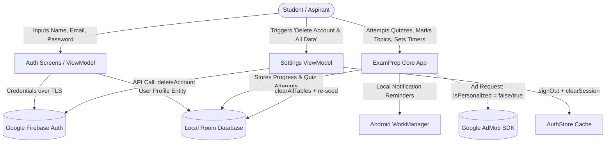

# ExamPrepOS — Data Inventory & Lifecycle Specification

> **Compliance Classification**: Technical Privacy Assessment & Data Mapping  
> **Applicable Regulations**: Google Play User Data Policy, Indian Digital Personal Data Protection Act (DPDPA), 2023, Information Technology Act, 2000 & 2011 Privacy Rules.  
> **Status**: Verified against Codebase Implementation (`app`, `data`, `domain`, `core`)  
> **Last Updated**: October 2026

---

## 1. Executive Data Processing Overview

ExamPrepOS is designed with an **offline-first and data-minimization architecture**. The vast majority of user data (study plans, syllabus checkmarks, quiz attempts, flashcard ratings, exam targets) is stored exclusively on the user's physical Android device within an isolated SQLite database managed via AndroidX Room.

Cloud processing is restricted to:
1. **Google Firebase Authentication**: For secure email/password credential verification and account identifier binding.
2. **Google Mobile Ads (AdMob)**: For serving contextual banner and interstitial ads, with user-configurable non-personalized advertising (NPA).

---

## 2. Comprehensive Data Inventory Matrix

| Data Item / Category | Collected? | Stored? | Where? | Purpose | Required? | Shared? | Retention Period | Deletion Mechanism | Consent Required? |
|---|---|---|---|---|---|---|---|---|---|
| **User Full Name** | Yes | Yes | Local SQLite (`UserProfileEntity`) & Firebase Auth Profile | User personalization and dashboard greeting | Optional (defaults to "Aspirant") | No (isolated to Firebase Auth) | Retained until account/app deletion | In-app "Delete Account & All Data" or uninstall | No (contractual/user input) |
| **Email Address** | Yes | Yes | Local SQLite & Firebase Auth | User authentication, account recovery, password reset | Required for account sync; Optional for guest offline mode | Shared with Google Firebase Auth (Authentication Service Provider) | Retained until account deletion | In-app "Delete Account & All Data" or Firebase Console request | Yes (user initiates signup) |
| **Password Hash** | No (Client stores no plaintext) | Yes (Cryptographic hash) | Google Firebase Auth Servers | Account authentication | Required for registered account | Handled by Google Firebase Auth | Managed by Firebase Auth SLA | Automated on account deletion | Yes (standard auth) |
| **Target Exam Selection** | Yes | Yes | Local SQLite (`UserProfileEntity`) | Filter syllabus topics, mock tests, and subject trackers | Required for core app functionality | No (100% local) | Retained until user reset or uninstall | In-app "Delete Account & All Data" or clearing app data | No (core feature selection) |
| **Daily Study Target (Hours)** | Yes | Yes | Local SQLite (`UserProfileEntity`) | Calculate progress meters and streak targets | Optional (defaults to 4 hrs) | No (100% local) | Retained until user reset or uninstall | In-app "Delete Account & All Data" or clearing app data | No (study preference) |
| **Study Schedule Preferences** | Yes | Yes | Local DataStore / App State | Set daily alarm/notification timing | Optional (defaults to 8:00 AM) | No (100% local) | Retained until user reset or uninstall | In-app "Delete Account & All Data" or clearing app data | No (functional setting) |
| **Syllabus Progress & Checkmarks** | Yes | Yes | Local SQLite (`TopicProgressEntity`, `ChapterEntity`) | Visual progress tracking across exam syllabus | Required for core functionality | No (100% local) | Retained until user reset or uninstall | In-app "Delete Account & All Data" or clearing app data | No (functional progress) |
| **Quiz Attempts & Answers** | Yes | Yes | Local SQLite (`QuizAttemptEntity`) | Score calculation, accuracy metrics, weak area diagnosis | Required for mock test functionality | No (100% local) | Retained until user reset or uninstall | In-app "Delete Account & All Data" or clearing app data | No (functional progress) |
| **Flashcard Review Records** | Yes | Yes | Local SQLite (`FlashcardReviewEntity`) | Spaced repetition algorithm (SM-2 intervals) | Required for flashcard review | No (100% local) | Retained until user reset or uninstall | In-app "Delete Account & All Data" or clearing app data | No (functional progress) |
| **Question Bookmarks** | Yes | Yes | Local SQLite (`BookmarkEntity`) | User-saved questions for later revision | Optional (user-initiated) | No (100% local) | Retained until user reset or uninstall | In-app "Delete Account & All Data" or un-bookmarking | No (user-initiated action) |
| **Offline Question Paper Downloads** | Yes | Yes | Local SQLite (`ExamEntity`, `QuestionEntity`) | Enable 100% offline study without network access | Optional (user-initiated) | No (100% local) | Retained until user reset or uninstall | In-app "Delete Account & All Data" or library remove | No (user-initiated download) |
| **Advertising ID (GAID)** | Yes (via Google Mobile Ads SDK) | Transient in SDK / Google Play Services | Google Play Services / AdMob network | Ad fraud prevention, frequency capping, ad measurement, optional ad personalization | Automatic via Google Play Services when network is available | Shared with Google AdMob / advertising partners | Governed by Google Advertising Privacy Policy (up to 13 months) | User can reset GAID in Android Settings or toggle "Personalized Ads" OFF in app Settings | Yes (Consent via Settings toggle, defaulted to non-personalized `npa=1`) |
| **Device / Diagnostics Info** | Yes (System level) | No (Local Timber debug logs only in Debug builds) | Ephemeral logcat memory | Debugging and ANR detection | Automatic | No crash reporting SDK (Crashlytics not bundled) | Not retained on servers | Discarded upon process termination | No (internal debugging) |
| **Precise GPS Location** | **NO** | **NO** | N/A | Not collected or requested | N/A | None | N/A | N/A | N/A |
| **Camera & Microphone** | **NO** | **NO** | N/A | Not collected or requested | N/A | None | N/A | N/A | N/A |
| **Contacts & Phonebook** | **NO** | **NO** | N/A | Not collected or requested | N/A | None | N/A | N/A | N/A |
| **Financial / Bank Account Data** | **NO** | **NO** | N/A | All future purchases processed exclusively by Google Play Billing | N/A | Google Play handles payment tokens | Governed by Google Play Billing Terms | Managed by Google Play Store | N/A |
| **Government IDs / Biometrics** | **NO** | **NO** | N/A | Never collected | N/A | None | N/A | N/A | N/A |

---

## 3. Data Flow Diagram

---

## 4. Retention Policy Specification

1. **Local Sandbox Storage**:
   - Stored in the app's internal database directory (`/data/user/0/com.examprep.android/databases/examprep.db`).
   - Retained as long as the application remains installed on the device, or until the user triggers "Delete Account & All Data" in Settings.
   - Propose retention schedule: **Indefinite on-device retention** under the user's direct physical custody.

2. **Cloud Authentication Records (Firebase)**:
   - Stored on Google Cloud Platform (Firebase Auth) in compliance with SOC 2, ISO 27001, and Indian data protection principles.
   - Retained until the user requests account deletion.
   - Deletion occurs synchronously when triggered from the in-app Privacy & Legal settings.

3. **Publisher Approval Required**:
   - `[FLAG FOR PUBLISHER APPROVAL]`: Confirm whether an automated inactive-account purge policy (e.g., purging accounts inactive for > 24 months) should be established on the Firebase Console.

---

## 5. Summary of Compliance Status

- **Data Minimization Principle (DPDPA 2023 Sec 6)**: PASS. Only minimum necessary data for authentication and study scheduling is collected.
- **Purpose Limitation Principle (DPDPA 2023 Sec 7)**: PASS. Data collected is strictly used for study management and test performance evaluation.
- **Storage Limitation Principle**: PASS. Local data stays on the device; cloud credentials deleted upon user command.
