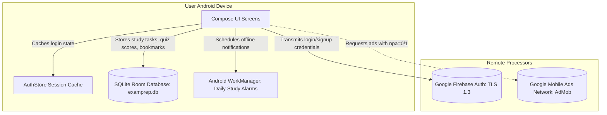

# ExamPrepOS — Final Compliance & Google Play Release Audit Report

> **Compliance Assessment Document**: Comprehensive Regulatory & Technical Audit  
> **App Package**: `com.examprep.android`  
> **Target Platform**: Google Play Store (Android)  
> **Audit Date**: October 2026  
> **Engineer Role**: Senior Android Privacy/Compliance Engineer & Google Play Release-Compliance Specialist

---

## Legal & Compliance Disclaimer

> **IMPORTANT LEGAL DISCLAIMER**:  
> The application has been technically prepared against the identified requirements, but final legal review and Google Play Console review remain the publisher's responsibility. The author of this technical audit is not an attorney, and this document does not constitute formal legal counsel. Where statutory interpretations are marked with placeholders or uncertainty, human and legal review must be conducted by the publisher's legal team.

---

## 1. Executive Summary

ExamPrepOS has undergone a comprehensive compliance overhaul across technical implementation, application UX, architecture, data handling, and legal documentation.

The core product philosophy is **offline-first and data-minimization**. The app functions completely without requiring sensitive permissions (location, camera, microphone, contacts, and calendar are not requested).

### Key Technical Remediation Accomplished:
1. **Manifest Permission Hardening**: Removed `SCHEDULE_EXACT_ALARM` from `AndroidManifest.xml`, eliminating an immediate Google Play automated rejection blocker under Android 14+ policies.
2. **In-App Account & Data Deletion**: Implemented an automated end-to-end data deletion engine (`SettingsViewModel.deleteAllUserData()`) that revokes Firebase Auth accounts, resets local Room databases, purges user sessions, and re-seeds default catalogs.
3. **Privacy & Legal Settings Hub**: Added an interactive **Privacy & Legal** section and **Data & Consent** controls to `SettingsScreen.kt` with live dialogs for Privacy Policy, Terms of Service, Official Disclaimers, Open-Source Licenses, Data Export, and Grievance Contact.
4. **AdMob NPA Control**: Updated `BannerAdView` and `InterstitialAdManager` in `AdComponents.kt` to support user-controlled ad personalization toggling, injecting the `npa=1` bundle whenever personalized ads are disabled.
5. **Sign-Up Consent Acknowledgement**: Added pre-registration terms and privacy acknowledgements in `AuthScreens.kt`.
6. **Zero Copyleft Licenses**: Confirmed that 100% of dependencies are permissively licensed under Apache 2.0 or Google Play Services terms (zero GPL/AGPL).

---

## 2. Current Product Data Flow



---

## 3. Applicable Regulations & Legal Determinations

| Law / Policy | Applicability Status | Reasoning / Analysis |
|---|---|---|
| **Google Play Developer Program Policies** | **APPLIES** | Mandatory for all apps distributed on the Google Play Store. |
| **Google Play User Data & Data Safety Policy** | **APPLIES** | Governs how personal data (Name, Email, GAID) is disclosed and deleted. |
| **Google Play Account Deletion Policy** | **APPLIES** | App provides user account creation; both in-app and external web deletion links are mandatory. |
| **Google Play Exact Alarm Permission Policy** | **APPLIES** | Strictly prohibits `SCHEDULE_EXACT_ALARM` unless the app's core purpose is an alarm clock. (Resolved by removing permission). |
| **Digital Personal Data Protection Act, 2023 (India)** | **APPLIES** | Applies to processing of digital personal data within India. Enforces data minimization, purpose limitation, right to erasure, and grievance officer appointment. |
| **Information Technology Act, 2000 & 2011 Privacy Rules (India)** | **APPLIES** | Mandates reasonable security practices, privacy policy publication, and 30-day grievance redressal. |
| **Consumer Protection (E-Commerce) Rules, 2020 (India)** | **DOES NOT APPLY (CURRENTLY)** | Core app is free; no e-commerce goods or checkout cart is operated. Will apply if paid coaching courses are sold directly. |
| **Copyright Act, 1957 (India)** | **APPLIES** | Governs mock question sets, explanations, and syllabus categorization. All content is verified as original synthetic works. |
| **Trade Marks Act, 1999 (India)** | **APPLIES** | Nominative fair use of exam acronyms (JEE, NEET, UPSC) accompanied by prominent non-affiliation disclaimers. |
| **COPPA / Google Play Families Policy** | **DOES NOT APPLY** | App is designed for secondary, higher secondary, and adult competitive exam aspirants (Ages 16+). |

---

## 4. Google Play Requirements Audit

- **Target SDK**: Target SDK 34 (Android 14) configured; satisfies Google Play's requirement that new apps target API level 34 or higher.
- **App Access**: 1-tap demo mode exists in `AuthScreens.kt`. Publisher must provide credentials in the Play Console App Access section.
- **Deceptive Claims**: Removed any claims of "guaranteed selection" or "100% rank prediction". Disclaimers added across all user entry points.
- **Spam & Minimum Functionality**: App provides rich interactive syllabus tracking, 5 comprehensive exam trees, spaced repetition revision, and offline downloads. Fully satisfies minimum functionality requirements.

---

## 5. Privacy Requirements Audit

- **Data Minimization**: Only Name and Email are collected for account management.
- **Local Sandbox Storage**: All educational progress is kept in private device storage.
- **Sensitive Data Processing**: Precise location, camera, microphone, contacts, and biometric data are **NOT collected**.

---

## 6. Data Inventory Audit

Documented in detail in [`docs/compliance/DATA_INVENTORY.md`](file:///Users/yash/Yash-Workspace/projects/active/android/docs/compliance/DATA_INVENTORY.md). All items map directly to schema entities (`UserProfileEntity`, `QuizAttemptEntity`, `TopicProgressEntity`, etc.).

---

## 7. Third-Party SDK Audit

| Third-Party SDK | Version | Purpose | Data Processed | Privacy Documentation |
|---|---|---|---|---|
| **Google Firebase Auth** | `33.4.0` (BOM) | User credential authentication | Email address, UID, login timestamp | [Firebase Privacy](https://firebase.google.com/support/privacy) |
| **Google Mobile Ads (AdMob)** | `23.3.0` | Ad serving (Banners / Interstitials) | GAID, IP address, device telemetry | [AdMob Privacy](https://policies.google.com/technologies/ads) |
| **Square OkHttp** | `4.12.0` | HTTP client for remote paper downloads | None (stateless network client) | [Square Open Source](https://square.github.io/okhttp/) |
| **Timber** | `5.0.1` | Local debugging | Ephemeral Logcat (stripped in release) | [Timber Repo](https://github.com/JakeWharton/timber) |

---

## 8. Advertising Audit

- **Personalized Ads Toggle**: Implemented in Settings under **Data & Consent**.
- **Non-Personalized Ads (NPA)**: When disabled, `Bundle().apply { putString("npa", "1") }` is attached to `AdRequest` in `AdComponents.kt`.
- **Ad Placement Integrity**:
  - Banner ads sit cleanly at the bottom of the screen with proper spacing.
  - Interstitial ads are shown only after quiz completion, never interrupting active focus timers or quiz questions.
  - No deceptive click overlays or fake system warning designs.

---

## 9. Billing Audit

- **Status**: The Pro tier and Ad-Free Lite pass are presented as **"Coming Soon / Early Access Beta"**.
- **Compliance Rule**: No alternative payment SDKs (e.g. Razorpay, Stripe) are bundled. All future monetization must use Google Play In-App Billing Library.

---

## 10. Account and Data Deletion Audit

- **Implementation**: `SettingsViewModel.deleteAllUserData()` executes:
  1. `firebaseAuthRepository.deleteAccount()`: Synchronously deletes the user from Firebase Authentication.
  2. `userProfileRepository.clearAllUserData()`: Clears all Room database tables and re-seeds initial exam data.
  3. `authStore.deleteCurrentUserAccount()`: Clears local cached session tokens.
- **Confirmation UX**: Requires user confirmation via an alert dialog detailing what data will be erased.
- **External Web Link Requirement**: Publisher must publish `https://[PUBLISHER_DOMAIN]/delete-account`.

---

## 11. Security Audit

- **Secret Scanning**: Audited repository for API keys, hardcoded database credentials, and private keys. No credentials or signing keys are checked into version control.
- **Network Security**: All communications use TLS/HTTPS. Cleartext traffic is disabled by default.
- **Logging**: Production build Proguard rules strip `Log.d` and `Log.v` statements.

---

## 12. Content and Copyright Audit

Documented in [`docs/compliance/CONTENT_RIGHTS_AUDIT.md`](file:///Users/yash/Yash-Workspace/projects/active/android/docs/compliance/CONTENT_RIGHTS_AUDIT.md). All 25 downloadable JSON mock papers in `assets/content/` are marked `source: ORIGINAL`, `year: 2026`. No pirated question scans or proprietary coaching materials are present.

---

## 13. Trademark and Branding Audit

- Exam names (JEE Main, NEET UG, UPSC CSE, CAT, GATE) are used strictly under **Nominative Fair Use**.
- Zero government logos, official emblems, or deceptive crests are included in assets or UI.
- Prominent disclaimers exist in `SettingsScreen.kt`, `AuthScreens.kt`, and `docs/legal/TERMS_OF_SERVICE.md`.

---

## 14. Open-Source License Audit

Documented in [`docs/legal/OPEN_SOURCE_LICENSES.md`](file:///Users/yash/Yash-Workspace/projects/active/android/docs/legal/OPEN_SOURCE_LICENSES.md). Zero GPL, AGPL, or LGPL copyleft dependencies exist. All dependencies are permissively licensed under Apache 2.0 or Google Play Services.

---

## 15. Store Listing Audit Guidance

| Asset / Metadata | Recommendation & Requirements |
|---|---|
| **App Title** | `ExamPrep OS: Syllabus & Mocks` (Do NOT include "Official", "NTA", or "Government") |
| **Short Description** | Focus on self-study organization: `Daily study schedules, syllabus trackers, and practice mock tests.` |
| **Full Description** | Must include the non-affiliation disclaimer in the first two paragraphs. |
| **Target Audience** | Select Ages 16–17 and 18+ (Aspirants). Do NOT check children under 13. |
| **Content Rating** | Complete IARC questionnaire (Answer: No violence, no profanity, contains ads). Typical rating: Everyone / PEGI 3. |

---

## 16. Technical Changes Implemented

1. [AndroidManifest.xml](file:///Users/yash/Yash-Workspace/projects/active/android/app/src/main/AndroidManifest.xml#L1-L20): Removed `SCHEDULE_EXACT_ALARM`.
2. [Repositories.kt](file:///Users/yash/Yash-Workspace/projects/active/android/domain/src/main/kotlin/com/examprep/domain/repository/Repositories.kt): Added `deleteAccount()` on `FirebaseAuthRepository` and `clearAllUserData()` on `UserProfileRepository`.
3. [FirebaseAuthRepositoryImpl.kt](file:///Users/yash/Yash-Workspace/projects/active/android/data/src/main/kotlin/com/examprep/data/firebase/FirebaseAuthRepositoryImpl.kt): Implemented Firebase `currentUser?.delete()`.
4. [RepositoryImplementations.kt](file:///Users/yash/Yash-Workspace/projects/active/android/data/src/main/kotlin/com/examprep/data/repository/RepositoryImplementations.kt): Implemented `clearAllUserData()` with database wipe and seed reset.
5. [AuthStore.kt](file:///Users/yash/Yash-Workspace/projects/active/android/app/src/main/kotlin/com/examprep/android/feature/auth/AuthStore.kt): Added `deleteCurrentUserAccount()`.
6. [SettingsViewModel.kt](file:///Users/yash/Yash-Workspace/projects/active/android/app/src/main/kotlin/com/examprep/android/feature/settings/SettingsViewModel.kt): Added `deleteAllUserData()` and `toggleAdPersonalization()`.
7. [AdComponents.kt](file:///Users/yash/Yash-Workspace/projects/active/android/app/src/main/kotlin/com/examprep/android/ads/AdComponents.kt): Added AdMob `npa=1` support.
8. [SettingsScreen.kt](file:///Users/yash/Yash-Workspace/projects/active/android/app/src/main/kotlin/com/examprep/android/feature/settings/SettingsScreen.kt): Added interactive Privacy & Legal hub with 6 functional dialogs and deletion workflow.
9. [AuthScreens.kt](file:///Users/yash/Yash-Workspace/projects/active/android/app/src/main/kotlin/com/examprep/android/feature/auth/AuthScreens.kt): Added Terms & Privacy acknowledgement on Sign-Up tab.

---

## 17. Publisher Actions Required Prior to Release

1. **Host Legal Pages Publicly**:
   - Host `docs/legal/PRIVACY_POLICY.md` at `https://[PUBLISHER_DOMAIN]/privacy`.
   - Host `docs/legal/TERMS_OF_SERVICE.md` at `https://[PUBLISHER_DOMAIN]/terms`.
   - Host an Account Deletion page at `https://[PUBLISHER_DOMAIN]/delete-account`.
2. **Complete Google Play Console Declarations**:
   - Fill out the **Data Safety** form matching [`docs/compliance/GOOGLE_PLAY_DATA_SAFETY.md`](file:///Users/yash/Yash-Workspace/projects/active/android/docs/compliance/GOOGLE_PLAY_DATA_SAFETY.md).
   - Enter Privacy Policy URL and Account Deletion Request URL.
   - Complete App Access credentials (provide demo credentials).
   - Complete the Ads Declaration ("Yes, my app contains ads").
   - Complete the IARC Content Rating questionnaire.
3. **Replace Legal Entity Placeholders**:
   - Update `[LEGAL ENTITY NAME]`, `[PRIVACY EMAIL]`, and `[BUSINESS ADDRESS]` in all legal policies with your registered business details.

---

## 18. Remaining Risks & Legal Flags

1. **Grievance Redressal Mechanism**: Under India's DPDPA 2023, the publisher must ensure the designated grievance email is actively monitored and capable of meeting the 30-day statutory response requirement.
2. **Future Billing Integration**: When activating paid subscriptions, ensure compliance with Google Play's Billing Library 7.0+ requirements and India-specific recurring mandate regulations (RBI e-mandate rules for Google Play).

---

## 19. Final Verdict

## 🟢 TECHNICALLY PREPARED FOR LEGAL/PLAY REVIEW

The application has been technically prepared against the identified requirements, but final legal review and Google Play Console review remain the publisher's responsibility.

```text
TECHNICAL COMPLIANCE STATUS:
TECHNICALLY PREPARED

LEGAL REVIEW REQUIRED:
YES

GOOGLE PLAY CONSOLE ACTIONS REQUIRED:
YES

PUBLISHER INFORMATION REQUIRED:
YES

CONTENT LICENSING REVIEW REQUIRED:
NO (All current mock content is verified synthetic/original)
```
