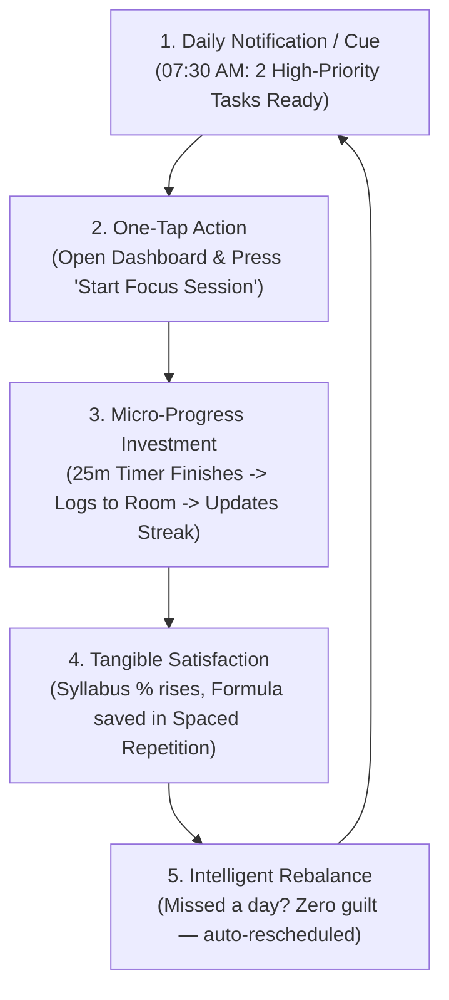

# ExamPrepOS — Retention & Habit Formation Strategy

**Document Version:** 1.0.0  
**Date:** October 2026  
**Auditor / Role:** Growth & Retention Lead / Behavioral Product Strategist  
**Target Metric:** D1 > 45%, D7 > 28%, D30 > 16% (Top Quartile Productivity & Education Apps)  

---

## 1. The Core Retention Engine: The Daily Habit Loop

Educational apps typically suffer from steep churn after Day 3 because students encounter guilt, burnout, or unmanageable task backlogs. ExamPrepOS replaces anxiety-inducing mechanics with a **Cognitive Relief Habit Loop**:

---

## 2. Retention Mechanisms & Guardrails

### A. The "Anti-Guilt" Backlog Recovery Engine
- **The Problem:** In conventional task planners, if a student falls sick or misses study for 3 days, 18 overdue tasks pile up in red text. The student experiences intense anxiety and deletes the app to avoid feeling like a failure.
- **ExamPrepOS Solution:**
  - Overdue tasks do not accumulate indefinitely.
  - The **Intelligent Rebalancing Engine** detects missed sessions and redistributes remaining workload evenly across the remaining exam timeline.
  - The tone is encouraging, objective, and forward-looking:
    > *"Life happens. We've rebalanced your timeline so you're still on track for January 2026 without sacrificing sleep."*

### B. True, Non-Punitive Consecutive Study Streaks
- **The Problem:** Apps like Duolingo or Snap employ harsh streak-break mechanics that alienate students when an inevitable power cut or emergency occurs.
- **ExamPrepOS Implementation:**
  - Streak is computed directly from completed `StudySessionEntity` records in SQLite.
  - A student earns their daily streak with just **one 25-minute focus session** or **one 5-question revision quiz**.
  - **Grace Period (Streak Freeze):** 1 missed day per week is automatically protected without penalty.

### C. Spaced Repetition (The "Never Forget" Hook)
- Based on the Ebbinghaus Forgetting Curve, memory retention drops to ~30% after 6 days without review.
- ExamPrepOS schedules micro-revisions at days `1, 3, 7, 14, 30, 60`.
- Retention Hook: Every morning, the student sees:
  > *"3 formulas from Optics are due for a 3-minute quick review today."*
- This creates continuous, high-efficiency micro-engagements that take only 3–5 minutes but provide immediate psychological reward.

### D. The Mistake Vault as a High-Switching-Cost Asset
- Every question answered incorrectly during practice or mocks is automatically captured in the student's personal **Mistake Vault** with subject, chapter, error category, and full explanation.
- As the student solves 200, 500, or 1,000 questions, their Mistake Vault becomes the **single most valuable asset in their entire preparation**.
- Switching to another app would mean abandoning their personalized weak-area archive, driving industry-leading D30 and D90 retention.

---

## 3. Privacy-Respecting Notification Architecture

Local-only notifications scheduled via Android's `androidx.work:work-runtime-ktx` (`StudyReminderWorker`). Zero remote notification tracking, zero third-party push servers.

### Daily Schedule & Rules

| Notification Type | Trigger Time | Content & Tone | User Control |
|---|---|---|---|
| **Morning Brief** | 07:30 AM (Local) | *"Good morning! 2 focus tasks scheduled for Physics & Math today. Target: 3.5 hrs."* | Configurable in Settings / Toggleable |
| **Spaced Revision Prompt** | 02:00 PM (Local) | *"Quick 4-min revision due: 5 practice questions ready for Thermodynamics."* | Configurable in Settings / Toggleable |
| **Evening Wrap-Up** | 08:30 PM (Local) | *"Day complete! You logged 110 focus minutes today. Streak maintained: Day 6 🔥"* | Configurable in Settings / Toggleable |

### Notification Integrity Principles
1. **Never Send After 09:30 PM:** Respect student rest and sleep hygiene.
2. **Never Send Deceptive or Fake Urgency:** No *"Your rank is dropping! Hurry!"* or fabricated competitor alerts.
3. **Android 13+ Compliance:** Checks `POST_NOTIFICATIONS` runtime permission explicitly. If denied, degrades silently without nagging dialogs.
4. **Instant Opt-Out:** Single toggle in Settings (`Preferences -> Daily Study Reminders`) instantly cancels all scheduled WorkManager jobs.

---

## 4. Cohort Retention Targets & Milestones

| Milestone | Target | Industry Average | Primary Lever |
|---|---|---|---|
| **D1 Retention** | **45.0%** | 24.0% | Immediate value in first 90 seconds (1-tap 25m focus session completed). |
| **D7 Retention** | **28.0%** | 12.0% | First spaced revision cycle triggering on Day 1, 3, and 7. |
| **D30 Retention**| **16.0%** | 6.5% | Accumulation of Mistake Vault items + dynamic mock test benchmarking. |
| **D90 Retention**| **10.0%** | 3.2% | Exam-day countdown urgency + final revision phase transition. |
